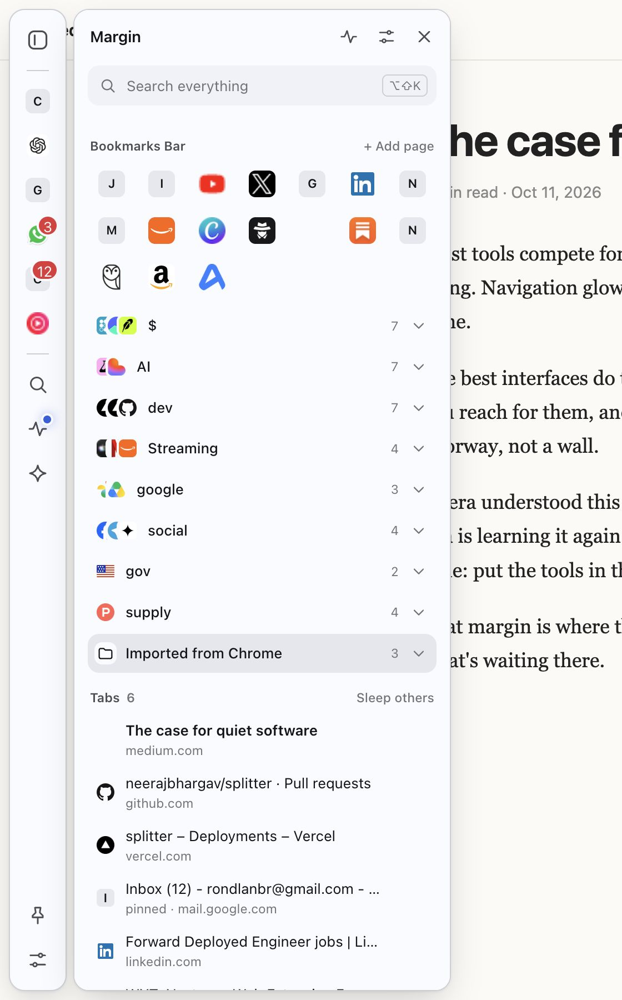
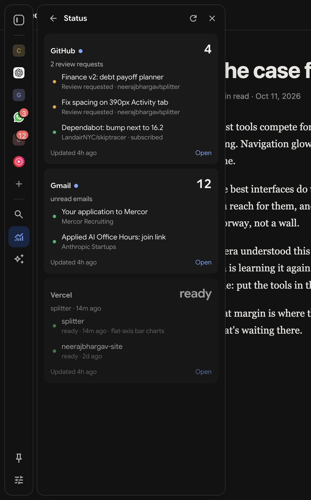
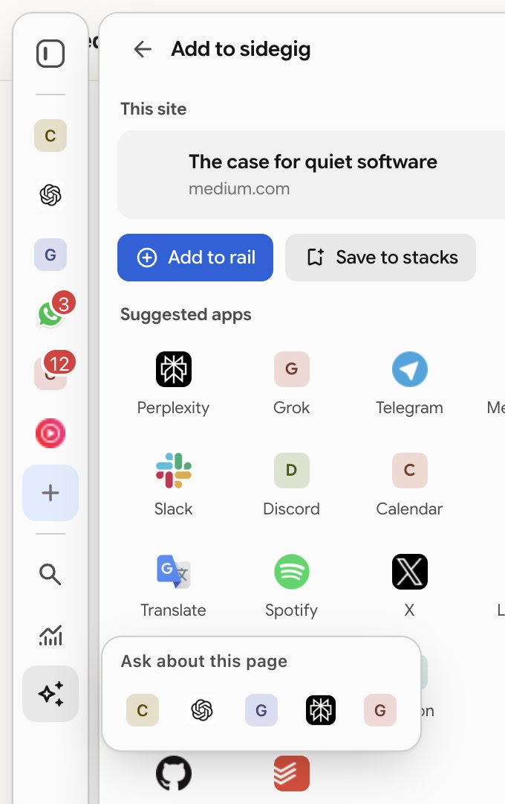

# sidegig

**Your apps, bookmarks and daily tools, close while you browse.** sidegig is a free, open-source browser sidebar with an optional new tab. Start with a short setup, pin the apps you use, and make room for your day.

No account. No servers. No analytics. Works in Chrome, Edge, Brave, Arc, Dia, Vivaldi, Opera, Aside, Firefox and Safari.

<p>


</p>

How it got here: [screenshots of every milestone](docs/evolution/README.md) and the [changelog](CHANGELOG.md).

## Why

Opera's sidebar proved how good it is to keep messengers and tools one click away. Arc and Dia showed how calm a browser can feel. Most sidebar extensions today either open a second browser pane on the right or put features behind a subscription. sidegig is built to be:

- **Quick.** The rail is drawn on the page itself, appears after a 120 ms touch of the edge, and the drawer is preloaded so it opens instantly.
- **Always there, like Opera's sidebar.** Docked by default: the rail sits flush on the side you choose and every page makes room for it, so nothing is ever covered. Prefer more space? Switch to hover.
- **Customizable.** Any site as an app, any bookmark folder as a space, theme from three inputs, custom CSS, per-site hiding, link rules.
- **Adaptive.** By default it matches each website's light or dark look. Text contrast is checked by tests at every setting.
- **Minimal and good looking.** Chrome's own design language: Google Sans Flex, Material Symbols, tonal surfaces, nothing loud until it has something to say.
- **Free for everyone.** GPL-3.0. No paid tier, ever.

## Features

| | |
|---|---|
| **Docked rail** | Always visible on the left or right, and the page makes room for it like Opera's sidebar: fixed headers, side navs and overlays are moved clear of it automatically (tested on YouTube, X, Gmail, LinkedIn, GitHub, Wikipedia). Opening the drawer makes room too. Or switch to hover, where it slides over the page from the edge. |
| **Opera-style panel** | Apps open in the browser's sidebar laid out like Opera: buttons list on the outer edge, the app right beside it. When the panel opens on the rail's side, the page rail steps aside so it reads as one sidebar. If the browser puts its sidebar on the other side, sidegig offers a one-click fix. |
| **Apps** | Claude, ChatGPT, Gemini, Perplexity, Grok, WhatsApp, Telegram, Slack, Discord, Gmail, Calendar, YouTube Music, Spotify, Notion, Linear, GitHub and more, or any site. Opens in the browser's own sidebar (where your sign-ins work), a slim mini window, a tab, or an in-page drawer. Unread badges from page titles. |
| **Add this site** | The **+** on the rail turns the page you're on into a rail app or a bookmark in one tap, with suggested apps below. |
| **One-tap AI** | The Ask button sends the page, or your selection, to your default AI. Hover it to pick Claude, ChatGPT, Gemini, Perplexity or Grok instead. Uses the account you're already signed in to: no API keys, no extra cost. sidegig types the prompt; you press send (or turn on auto-send). Also in the right-click menu. |
| **Sidebar assistant** | Built-in chat with the browser’s model, a local model or your own API provider. Attach tabs, use browser tools and connect MCP tool servers. Provider keys and tool tokens stay on the device. |
| **Bookmark stacks** | Your real browser bookmarks: folders become Dia/Arc-style stacks with overlapping site icons, loose bookmarks become an Opera-style icon grid. Pick folders as spaces. Syncs through the browser; stays yours if you uninstall. |
| **Tabs, Dia style** | This window's tabs with Chrome tab groups shown as colored sections. Close, switch, put background tabs to sleep, save the window as a workspace and restore it later. |
| **Search everything** | Open tabs, apps, bookmarks (with folder paths), history and commands in one fuzzy-matched list, plus web search. |
| **Status cards** | GitHub reviews and notifications, Vercel deployments, unread Gmail. Faded until something changes, then marked new; the rail glows. |
| **Link rules** | Send links for chosen sites to a mini window, or reuse a tab that's already open. |
| **New tab page** | Search box, apps, a speed dial of saved sites and your stacks. |
| **Your edition** | Every new tab carries a short, finite issue of articles, videos, podcasts, books, music and discussions picked from your interests, not from what keeps people scrolling. Your AI fills in your interests: one click types a prompt into Claude, ChatGPT or Gemini in the sidebar, and sidegig reads back only that JSON reply. Save what you like, wave off what you don't, and the next edition learns from both (interests from your AI or your saves fade over 60 days unless renewed; yours never do). A Saved shelf keeps your own curation, and right-click → “Save to your reading list” works on any page. Sources are free and keyless: Hacker News, Substack, Google News, YouTube, Apple Podcasts, Apple Music (opens in YouTube Music), Open Library, arXiv and Reddit. Where Chrome's built-in model is available, it reviews each edition on your computer and writes a one-line “why this is here” for every pick. |
| **Theme engine** | Base tint, accent and contrast generate the whole palette in OKLCH. Light, dark, system, or Page (match each site). Corner radius and custom CSS too. |

<p>



</p>


## Install

Have a built zip? Follow the [installation guide](INSTALL.md). Local Chromium builds use **Load unpacked**. Store publication and signed Firefox/Safari distribution remain separate steps.

On first install, sidegig opens a short setup for pinned apps, sidebar position and the optional new tab. Refresh existing web pages after installing.

### Build from source

```bash
git clone git@github.com:neerajbhargav/sidegig.git && cd sidegig
npm install
npm run build          # dist/chrome, dist/opera, dist/firefox, dist/safari
```

| Browser | How |
|---|---|
| Chrome, Edge, Brave, Arc, Dia, Vivaldi, Aside and other Chromium browsers | `chrome://extensions` → turn on **Developer mode** → **Load unpacked** → choose `dist/chrome` |
| Opera | `opera://extensions` → Developer mode → Load unpacked → `dist/opera` (sidegig also shows up in Opera's own sidebar) |
| Firefox | `about:debugging#/runtime/this-firefox` → **Load Temporary Add-on** → `dist/firefox/manifest.json` |
| Safari | `npm run safari` (needs Xcode), then build the generated project and enable sidegig in Safari settings |

`npm run zip` writes browser packages to `dist/`. The Chromium packages can be loaded locally. Firefox and Safari still need their browser-specific signing and distribution steps.

## Shortcuts

| | Windows / Linux | Mac |
|---|---|---|
| Show or hide the rail | `Alt+Shift+S` | `⌥⇧S` |
| Search everything | `Alt+Shift+K` | `⌥⇧K` |
| Ask AI about the page or selection | `Alt+Shift+A` | `⌥⇧A` |

Inside the drawer, `⌘K` / `Ctrl+K` jumps to search and `Esc` closes. Change shortcuts on your browser's extension shortcuts page.

## How it works

```
src/
  content/rail.ts      the hover rail, in a closed shadow root on every page (built lazily)
  content/bridge.ts    runs inside app sites: unread badges, typing AI prompts
  background/          opens apps, network rules, menus, alarms, status cards, workspaces
  ui/                  sidegig's pages: in-page drawer, browser sidebar panel, new tab
  options/             settings page
  shared/              theme engine, fuzzy search, storage, app catalog, rules, icons
scripts/               build (esbuild), per-browser manifests, asset fetching
test/                  node:test unit tests
```

- **Why draw the rail on the page instead of only using the browser's side panel?** Extensions can't draw in the browser's own window frame, and the side panel can't be narrower than 320 px or open on hover. A rail drawn on the page can be slim and instant. It can't appear on browser-internal pages (settings, extension stores, the PDF viewer); use the shortcut or toolbar button there.
- **How docking works.** The page's root element gets a margin the width of the rail. Fixed-position elements don't follow that margin, so `src/content/dock.ts` finds the ones that would land under the rail and moves or narrows just those with tagged stylesheet rules, re-checking as the page changes. The geometry lives in `src/shared/dockmath.ts` with unit tests. Sites that still misbehave can be set to float instead.
- **Why do apps open in the browser's sidebar?** Inside a normal web page, sites like Claude or WhatsApp count as embedded third parties and look signed out. In the browser's sidebar they keep your sign-in. sidegig lets them load there by adjusting frame-blocking headers *only for frames inside its own panel* (requests not tied to a browser tab), never for your normal browsing. Tests enforce that the rules never apply to top-level pages.
- **Cross-browser.** Chrome-family browsers use the side panel API, Opera and Firefox their sidebar API, Safari a mini window. One codebase, four generated manifests.

### The edition

`src/shared/edition/` holds the logic, all pure and unit-tested against saved real responses (`test/fixtures/edition`):

- `profile.ts`: your interests, the AI import prompt and parser, and learning (save +0.5, open +0.15, not for me −0.3, 60-day fade for anything you didn't type yourself).
- `sources.ts`: one search URL and one parser per source.
- `rank.ts`: scoring (interest weight × how well it matches × how much people valued it × freshness by kind), duplicate removal, and composition: every format you turned on gets a say, stronger interests earn more slots, nothing far weaker than the best pick gets in, and the issue ends.

`src/background/edition.ts` builds a new edition on a timer (every 12 hours by default), signed out, four requests at a time. To see what a profile would produce without the extension, put an AI reply in a file and run `node scripts/edition-dry-run.ts reply.txt`.

## Design system

- **Type:** Google Sans Flex (SIL OFL), Latin subset, 36 KB, bundled.
- **Icons:** Material Symbols Rounded (Apache-2.0), fetched by `scripts/fetch-assets.mjs`.
- **Color:** three inputs to an OKLCH palette, Linear-style; Google blue `#0b57d0` by default; neutral surfaces; contrast tested (body text ≥ 7:1, secondary ≥ 4.5:1).
- **Shape and motion:** 10 px radius, soft elevation only on floating surfaces, 120–220 ms transitions, respects reduced motion.

## Privacy

See [PRIVACY.md](PRIVACY.md) for exactly what is stored and which requests are made. Short version: nothing leaves your browser except requests to the sites and accounts you choose.

## Development

```bash
npm test         # unit tests (node:test)
npm run check    # TypeScript
npm run build    # all browsers, or build:chrome / build:firefox / build:opera / build:safari
npm run preview  # UI bundle with mocked browser APIs, used for screenshots
node scripts/fetch-assets.mjs   # refresh icons and font
```

The build uses native esbuild when it can and falls back to the WebAssembly build automatically.

## Known limitations

- Some sites refuse to work inside any frame; use "Open as mini window" for those.
- A few sites keep a separate sign-in inside the sidebar; signing in once there fixes it.
- Two accounts of the same app side by side needs Firefox containers (planned).
- Status cards for Claude Code / Codex usage need a small native helper (planned).

## License

[GPL-3.0-or-later](LICENSE). Bundled font and icons are covered by their own licenses; see [THIRD_PARTY_NOTICES.md](THIRD_PARTY_NOTICES.md).

### Check the product flows

`npm run preview` builds a standalone preview with persistent, isolated fixture storage. Serve `dist/` on port 8765 and open `http://127.0.0.1:8765/preview/`. The preview includes first install, new tab, sidebar and settings. Its reset button affects only preview data.

If you use the Aside CLI, run:

```bash
aside repl "$(cat scripts/product-smoke.js)"
```

The smoke test uses the local preview. It checks setup choices, note editing and reload, updates across two tabs, task completion, settings search, offline model discovery, sidebar assistant access and direct address navigation. It makes no paid model calls. Browser integrations and signed-in app frames need a separate installed-extension check.
