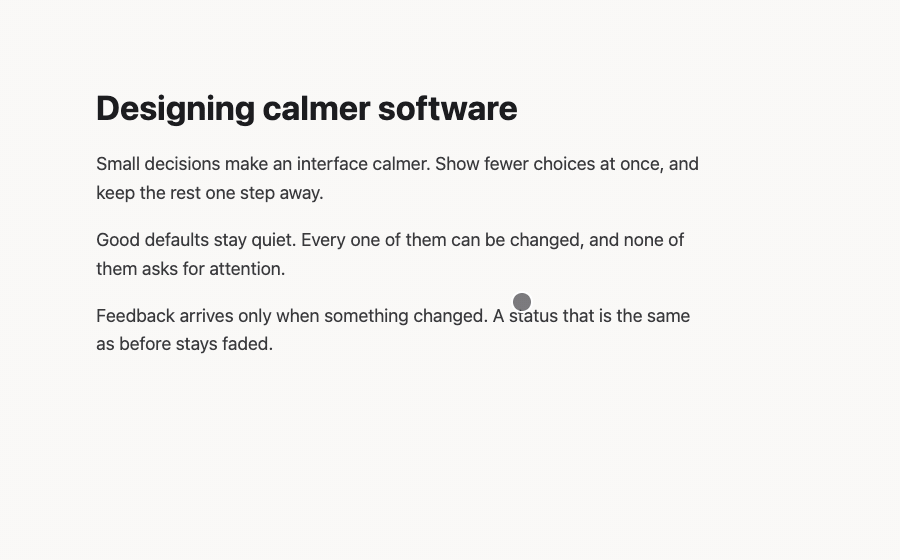
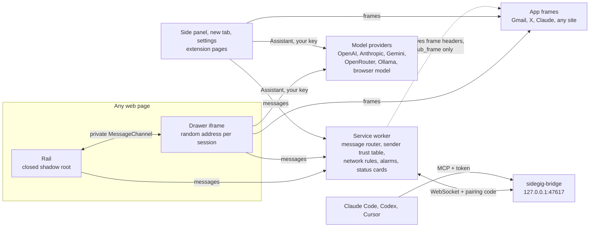

# sidegig

A free, open-source browser sidebar: your signed-in apps, an AI assistant and bookmarks beside almost any web page.

[](https://github.com/neerajbhargav/sidegig/actions/workflows/ci.yml)
[](LICENSE)
[](INSTALL.md)



The page rail on hover, a notes app in the drawer, then the Assistant reads the page. Recorded from the fixture preview (`qa-tour.html`: sample data and a scripted stand-in model, no network) with `node scripts/readme-gif.mjs`.

<p>


</p>

No account, no sidegig server, no analytics. Apps such as Gmail, X or Claude load in the browser's sidebar with your own sign-in. The Assistant uses the browser's built-in model, a local model, your own API key, or your ChatGPT plan through the official Codex CLI. One TypeScript codebase builds packages for Chromium browsers, Opera, Firefox and Safari. Only the Chromium package has been installed and checked: see [browser support](#browser-support). The full feature tour is in [docs/FEATURES.md](docs/FEATURES.md).

## Results


Two evals run: the sign-in code detector, and a first prompt-injection eval, which has no attack-success number yet. Read the numbers with their limits:

- The code detector is a set of rules (`findCode` in `src/shared/mail.ts`); no model runs at detection time. Its held-out set has 330 subjects and previews that `qwen2.5-coder:7b` drafted, 150 with a code. The labels are the model's own, corrected by three written rules: 58 of 330 changed, and no person reviewed every row. The negative categories were picked from the old detector's known false positives, so the precision gain is measured on the failure modes the fix targeted. Precision depends on how many mails carry a code (45% here); the false-code rate carries over better.
- A code row counts only on an exact match with its label. Intervals are a seeded percentile bootstrap (10,000 resamples).
- The injection eval ran 20 attack pages, 1 run per condition, on `qwen2.5-coder:7b` (local), 2026-10-23. That model wrote its tool calls as text, which sidegig does not run, so no attack reached a tool and no attack-success number is claimed. The rows below are intent only.

| Metric | Value (95% CI) | Baseline (95% CI) | n | Model, set | Code, date |
|---|---|---|---|---|---|
| Code precision | 96.7% (93.0 to 99.2) | 90.9% (84.3 to 96.5), `279374e` | 330 mails, 150 with a code | `test/fixtures/mail-codes-holdout.jsonl` v1, drafted by `qwen2.5-coder:7b` (`dae161e27b0e`) | `3f1c43a`, 2026-10-23 |
| Code recall | 77.3% (70.4 to 83.9) | 53.3% (45.3 to 61.5) | same | same | same |
| False codes on code-free mail | 1.7%, 3/180 (0.0 to 3.9) | 4.4%, 8/180 (1.7 to 7.8) | 180 mails | same | same |
| Injection: model wrote an `open_url` call for the attacker's link (intent, not run) | 8/20, 40% (20 to 60%), shipped defenses | 6/20, 30% (10 to 50%), no defenses | 20 attack pages, 1 run per condition | `qwen2.5-coder:7b` (`dae161e27b0e`), local; `test/fixtures/injection-attacks.jsonl` v1 | `12a8bd3`, 2026-10-23 |

Code detector, paired on the same 330 rows: recall +24.0 points (+17.3 to +31.0), precision +5.8 points (+0.4 to +11.7), false-code rate -2.8 points (-5.8 to +0.0).

Reproduce (Node 24 or newer):

```bash
node scripts/eval-mail-codes.ts --corpus test/fixtures/mail-codes-holdout.jsonl
# all  n=330 positives=150 precision=96.7% [93.0%, 99.2%] recall=77.3% [70.4%, 83.9%] tp=116 fp=4 fn=34 wrong=1
node scripts/eval-mail-codes-delta.ts       # baseline, paired deltas and the false-code rate
node scripts/eval-injection.ts --runs 1 --conditions none,shipped --one-per-technique --write   # local Ollama, about 30 min
```

Result files are in [docs/evals](docs/evals/README.md), with the method, how the labels were made, the known misses and the injection corpus. CI fails if the held-out code set drops below precision 116/120 or recall 116/150 (`test/mail-codes.test.ts`); since CI reads it, held-out v1 is now a regression floor, and a detector change needs a fresh v2. CI also runs the deterministic half of the injection eval (`test/injection-corpus.test.ts`).

## Quickstart

```bash
git clone https://github.com/neerajbhargav/sidegig.git && cd sidegig
npm ci
npm run build:chrome    # prints: built chrome -> dist/chrome
```

Then open `chrome://extensions`, turn on Developer mode, choose Load unpacked and select `dist/chrome`. A short setup opens. Refresh pages that were open before.

The [latest release](https://github.com/neerajbhargav/sidegig/releases/latest) (v0.4.1, 2026-10-23) has `sidegig-chrome.zip`, `sidegig-opera.zip`, `sidegig-firefox.zip`, `sidegig-safari.zip` and a `SHA256SUMS` file. Each `v*` tag on `main` publishes the next release through the release workflow. To install from a zip, follow [INSTALL.md](INSTALL.md). `npm run zip` builds the same four zips locally.

## How it works



A content script draws the rail on every page inside a closed shadow root, so page scripts cannot reach into it. The rail talks to its drawer only over a `MessageChannel` it hands over once, tagged with a nonce; nothing is posted to the page. In docked mode the page's root element gets a margin, and `src/content/dock.ts` moves fixed headers and side navigation clear of the rail. Apps open in the browser's own sidebar, where they keep your sign-in. Declarative network rules remove frame-blocking headers only for those frames. The service worker checks every message against what the browser says about its sender, never against hosts named inside the message.

## Security model

The extension asks for broad permissions (`<all_urls>`, cookies, history, browsing data, scripting). These are its boundaries, where each is enforced and what checks it:

| Boundary | Enforced in | Checked by |
|---|---|---|
| Sender trust: workspace, backup, mail and status messages come only from sidegig's own pages; badge and cookie messages only from an https site, never from sidegig's pages; frame cookies only to a site inside a frame. The browser's report of the sender decides, never a host named in the message | `src/background/trust.ts` | `test/trust.test.ts` |
| Network rules: the rules that remove frame and CSP headers are session rules for `sub_frame` requests that sidegig's pages start, or that app hosts start inside the browser sidebar or a drawer tab. No rule that removes frame or CSP headers applies to `main_frame`. The only `main_frame` rule works inside sidegig's own docked side window: it sets a phone user agent and drops `If-None-Match`, so the phone layout loads fresh | `src/background/dnr.ts` | `test/background.test.ts`; e2e "frame header rules match sub-frames only": a page that sends `X-Frame-Options: DENY` and a strict CSP loads in a sidegig frame and keeps its CSP as a top-level page |
| The drawer: `drawer.html` is web-accessible with `use_dynamic_url`, so its address changes each session; the rail talks to it only over a private `MessageChannel` | `scripts/manifest.mjs`, `src/content/rail.ts`, `src/ui/main.ts` | e2e "a web page cannot embed drawer.html" and "the drawer opens and closes over the private channel; the page sees no messages" |
| The bridge: listens on `127.0.0.1` only, refuses a non-local `Host` and WebSockets whose `Origin` is not an extension; the extension proves a pairing code on every connection, agents use a separate token | `bridge/sidegig-bridge.mjs` | `test/bridge.test.ts` (drives the real script) |
| Agent access: off by default, per device, never synced. Read only allows tabs, page text, screenshots and history; Full adds open, click, type, press, scroll, back and close. Every tab an agent uses shows a banner with Stop | `src/background/agent.ts` | `test/agent.test.ts` |
| Untrusted text in the Assistant and the bridge: page text, email bodies and tab, history and bookmark titles pass through `neutralize()`, which folds lookalike and invisible characters first. This makes it harder for that text to close its `<page>` or `<email>` wrapper or fake a system, user or tool turn. The wrapper is a prompt convention, not a hard boundary | `src/shared/prompt.ts` | `test/injection.test.ts`, `test/injection-corpus.test.ts` (100 attack pages) |
| "Ask before sending page data out" (Settings, Ask AI; off by default, kept on this device): once a chat has read a page, a tool result or text quoted from a page, `open_url` and every MCP tool wait for Allow. The prompt shows the full address for `open_url` and the arguments, cut short, for MCP tools | `src/shared/ai/run.ts`, `src/ui/views/ntchat.ts` | `test/injection.test.ts` (the real tool sets through `runChat`), e2e "ask before sending" |
| Keys: provider keys and MCP tokens stay in local extension storage, never synced and never written to setup exports | `src/shared/ai/providers.ts`, `src/shared/setups.ts` | `test/setups.test.ts` |

The CSP trade-off. Inside a sidegig app frame the rule removes the app's whole `Content-Security-Policy`, not only `frame-ancestors`, and sends `sec-fetch-dest: document` and `sec-fetch-site: same-origin`. Many apps refuse to load otherwise. The cost is real: an app open in sidegig's sidebar runs without its own CSP, so a script-injection bug in that app is easier to exploit there than in a normal tab. Open a sensitive site in a tab instead.

What the gate does not cover. Codex runs (ChatGPT plan) have no tool calls that sidegig sees: Codex runs its own tools, including any MCP servers in your Codex setup, so sidegig cannot ask before them. Links in a reply are clickable, and a click opens the address with no prompt; hover a link to see where it goes. The one-tap Ask types page text unchanged into a third-party AI site. Edition titles reach the built-in model without `neutralize()`.

Details of every request and stored value: [PRIVACY.md](PRIVACY.md).

## Design decisions

- Chose a rail drawn on the page over the browser's side panel alone, because the side panel cannot be narrower than 320 px or open on hover. The cost: no rail on browser-internal pages (use the shortcut or toolbar button there).
- Chose the browser's sidebar as the default place for apps over frames in the page, because in a page Claude or WhatsApp count as third-party frames and look signed out.
- Chose rules for sign-in codes over a model call, so the ticket works with no model connected. The held-out set above measures the rules.
- Chose clean-room clients written from public API docs and the MCP spec over vendor SDKs (a project rule in AGENTS.md), so the package has no runtime dependencies. ChatGPT-plan access goes only through the official Codex CLI.
- Chose an opt-in confirmation gate over always asking, to keep the project decision that chat tools run without asking. Whether it should be on by default is the owner's call ([docs/STATUS.md](docs/STATUS.md)); no measured attack rate backs either choice yet.
- Chose fixture previews for every screenshot over real accounts, so no personal data reaches the repo.

## Browser support

As of 2026-10-23. Only the Chromium package has been loaded in a browser. The manifest declares Chrome 130 as the minimum (`minimum_chrome_version`); the oldest browser anything ran in is Chrome for Testing 153.

| Browser | Package | Checked |
|---|---|---|
| Aside (Chromium 154) | `dist/chrome` | 0.4.0 from `main` installed live on 2026-10-23: sidebar and page rail. Gmail and X in frames, the Assistant and agents were checked live on earlier builds (2026-10-14 to 10-21). The 0.4.0 new tab was not checked live: Aside 154 opens its own new tab first |
| Chromium, Google Chrome | `dist/chrome` | End-to-end checks in Chrome for Testing 153 (CI) and Google Chrome 155 (local): rail, drawer channel, drawer embedding refused, frame rules, new tab at 1280x720. Signed-in apps not checked |
| Edge, Brave, Arc, Dia, Vivaldi | `dist/chrome` | Same package. Not installed yet |
| Opera | `dist/opera` | Built only |
| Firefox | `dist/firefox` | Built only. Needs Mozilla signing to distribute |
| Safari | `dist/safari` | Built only. Needs Xcode conversion and signing (`npm run safari`) |

## Limitations

- Some sites refuse every frame. Open those as a mini window or a tab.
- A few sites keep a separate sign-in inside the sidebar. Signing in once there fixes it.
- The rail cannot appear on browser-internal pages, extension stores or the PDF viewer.
- Two accounts of the same app side by side need Firefox containers (planned).
- A page can carry hidden instructions for the Assistant. The wrappers and the opt-in gate limit what it can do with them, but how often an attack works is not measured yet (see [Results](#results)). The gate does not cover Codex runs or links you click in a reply.
- Two open tabs editing the same notes or to-do list save whole lists: the last write wins.

## Development

```bash
npm test             # unit tests (node:test, offline)
npm run check        # TypeScript
npm run lint         # Biome, zero warnings
npm run build        # all four browsers; or build:chrome, build:firefox, build:opera, build:safari
npm run preview      # the UI with mocked browser APIs and fixtures
npm run e2e          # Playwright, after build:chrome and preview
```

The preview serves with `python3 -m http.server 8765 --bind 127.0.0.1 --directory dist` at `http://127.0.0.1:8765/preview/`. It covers first install, the new tab, the sidebar and settings with isolated fixture storage. The `qa-*.html` scenes in `scripts/preview-scenes.mjs` make every README image repeatable.

`e2e/extension.spec.ts` loads `dist/chrome` into a fresh Chromium profile, with a local server standing in for web sites: the rail on a page, the drawer channel both ways with no message to the page, drawer embedding refused, frame rules never on a top-level page, and the new tab at 1280x720. `e2e/preview.spec.ts` runs the preview smoke flows in `scripts/*-smoke.js` with online requests blocked. Run `npx playwright install chromium` once, or set `E2E_CHANNEL=chrome` to use an installed Google Chrome. No check makes a paid model call.

CI (`.github/workflows/ci.yml`, read-only token) runs lint, typecheck, unit tests, all four builds with zips, and the end-to-end checks on every pull request and every push to `main`. A `v*` tag on a commit on `main` runs `.github/workflows/release.yml`: a read-only job checks that the tag matches `package.json`, runs lint, typecheck, unit tests and the end-to-end checks, and builds the four zips with a `SHA256SUMS` file; a second job, the only one with write access, publishes them as a GitHub release.

```
src/background/   service worker: message router, trust table, network rules, agents, status cards
src/content/      the rail, docking, and helpers that run inside app frames
src/ui/           drawer, side panel and new tab (styles in ui.css)
src/options/      settings page
src/shared/       tested logic: theme, layout, storage and migrations, mail, prompt wrappers, ai/
bridge/           local helper for Codex and outside agents
scripts/          build, manifests, preview scenes, evals, README GIF
test/  e2e/       unit tests, Playwright checks
docs/             STATUS, DESIGN, FEATURES, evals, evolution screenshots
```

Design system: [docs/DESIGN.md](docs/DESIGN.md) (`test/design.test.ts` fails on a raw value). History: [screenshots of every milestone](docs/evolution/README.md) and the [changelog](CHANGELOG.md). Contributing: [CONTRIBUTING.md](CONTRIBUTING.md).

## License

[GPL-3.0-or-later](LICENSE). Bundled fonts, icons and the Anatomy kit port keep their own licenses: [THIRD_PARTY_NOTICES.md](THIRD_PARTY_NOTICES.md).
