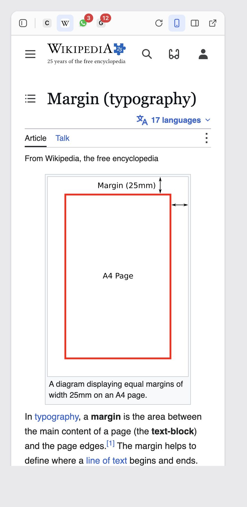
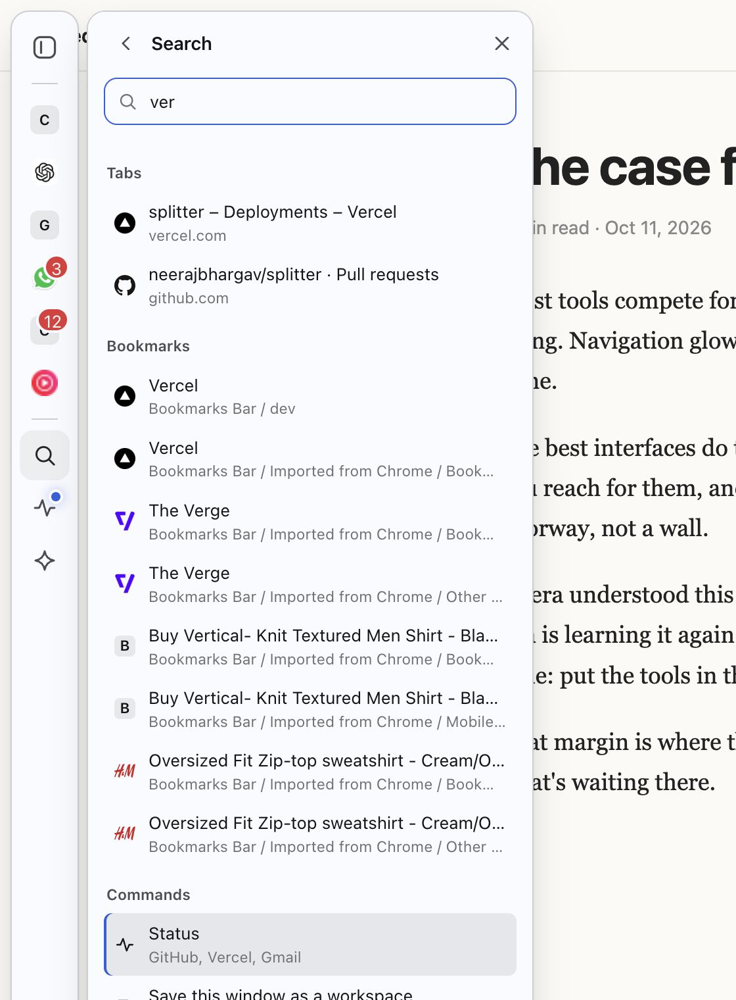

# Margin

A free, open-source sidebar that lives in the margin of every browser.

Move your pointer to the edge of any page and Margin slides in: your apps, one-tap AI, bookmark stacks, search across everything, and quiet status cards. Move away and it's gone. No account, no servers, no analytics.


## Why

Opera's sidebar showed how good it is to keep messengers and tools one click away. Arc and Dia showed how calm a browser can feel. Most sidebar extensions today either look like a second browser bolted onto the right side, or lock features behind a subscription. Margin aims to be quick, always there (or there on hover), customizable, and free for everyone, in whatever browser you already use.

## Features

| | |
|---|---|
| **Hover rail** | A slim strip appears when the pointer touches the left or right edge. Pin it to keep it visible, change its side and size, hide it on specific sites. |
| **Apps** | Claude, ChatGPT, Gemini, WhatsApp, Gmail, YouTube Music and 20 more presets, or any site you like. Opens in the browser's own sidebar (where your logins work), a slim mini window, a tab, or an in-page drawer. Unread badges come from the page title. |
| **One-tap AI** | Send the page or your selection to the AI you're already signed in to. No API keys, no extra cost. Margin types the prompt; you press send (or turn on auto-send). Also in the right-click menu and on `Alt+Shift+A`. |
| **Bookmark stacks** | Your real browser bookmarks as Dia/Arc-style stacks with overlapping site icons, plus an Opera-style icon grid for loose bookmarks. Pick folders as spaces. Syncs through the browser, and stays yours if you uninstall. |
| **Search everything** | `Alt+Shift+K` (⌥⇧K on Mac): open tabs, apps, bookmarks, history and commands in one fuzzy-matched list. |
| **Status cards** | GitHub reviews and notifications, Vercel deployments, unread Gmail. Cards stay faded until something changes, then glow. |
| **Tabs and workspaces** | See this window's tabs, save a window as a workspace and bring it back later, put background tabs to sleep. |
| **Link rules** | Send links for chosen sites to a mini window, or reuse an already-open tab. |
| **New tab page** | Search box, apps, a speed dial of saved sites and your stacks. |
| **Theme engine** | Three inputs (base tint, accent, contrast) generate the whole palette in OKLCH, so any combination stays readable. Light, dark, system, or *Page*: match each website's light or dark look. Custom CSS too. |

<p>



</p>


## Install (from source)

```bash
git clone <this repo> margin && cd margin
npm install
npm run build          # builds dist/chrome, dist/opera, dist/firefox, dist/safari
```

| Browser | How |
|---|---|
| Chrome, Edge, Brave, Arc, Dia, Vivaldi, Aside and other Chromium browsers | `chrome://extensions` → turn on **Developer mode** → **Load unpacked** → pick `dist/chrome` |
| Opera | `opera://extensions` → Developer mode → Load unpacked → `dist/opera` (Margin also appears in Opera's own sidebar) |
| Firefox | `about:debugging#/runtime/this-firefox` → **Load Temporary Add-on** → `dist/firefox/manifest.json` |
| Safari | `npm run safari` (needs Xcode), then build and run the generated project and enable Margin in Safari settings |

`npm run zip` also produces store-ready zips in `dist/`.

## Shortcuts

| | Windows / Linux | Mac |
|---|---|---|
| Show or hide the rail | `Alt+Shift+S` | `⌥⇧S` |
| Search everything | `Alt+Shift+K` | `⌥⇧K` |
| Ask AI about the page or selection | `Alt+Shift+A` | `⌥⇧A` |

Change them on your browser's extension shortcuts page.

## How it works

```
src/
  content/rail.ts      the hover rail, drawn in a closed shadow root on every page
  content/bridge.ts    runs inside app sites: unread badges, typing AI prompts
  background/          opens apps, network rules, menus, alarms, status, workspaces
  ui/                  Margin's pages: in-page drawer, browser sidebar panel, new tab
  options/             full settings page
  shared/              theme engine, fuzzy search, storage, catalog, rules, types
scripts/               build (esbuild) and per-browser manifest generation
test/                  node:test unit tests
```

- **Why a rail on the page, not just the browser's side panel?** Browsers don't let extensions draw in their own window frame, and the side panel can't be narrower than 320px or open on hover. A rail drawn on the page can be slim, instant and appear on hover. It can't appear on browser-internal pages (settings, extension stores, the PDF viewer); use the shortcut or toolbar button there.
- **Why do apps open in the browser's sidebar?** Inside a normal web page, sites like Claude or WhatsApp see themselves as embedded third parties and look signed out. In the browser's sidebar they keep your sign-in. Margin lets them load there by removing two frame-blocking headers *only for frames inside its own panel* (scoped to requests that don't belong to a tab), never for your normal browsing.
- **Cross-browser.** Chrome-family browsers use the side panel API; Opera and Firefox use their sidebar API; Safari uses a mini window.

## Privacy

Margin has no servers, accounts or analytics. See [PRIVACY.md](PRIVACY.md) for exactly what is stored and which requests are made.

## Development

```bash
npm test         # unit tests (node:test)
npm run check    # TypeScript
npm run build    # all browsers; or build:chrome, build:firefox, ...
npm run preview  # UI bundle with mocked browser APIs, used for screenshots
```

The build uses native esbuild when it can and falls back to the WebAssembly build automatically.

## Known limitations

- Some sites refuse to work inside any frame even with headers adjusted; use "Open as mini window" for those.
- A few sites store sign-ins separately when loaded inside the sidebar; signing in once there fixes it.
- Two accounts of the same app side by side needs Firefox containers (planned).
- Status cards for Claude Code / Codex usage need a small native helper (planned).

## License

[GPL-3.0-or-later](LICENSE). Margin is free software: use it, change it, share it. Anyone distributing a modified version must keep it open under the same license.
