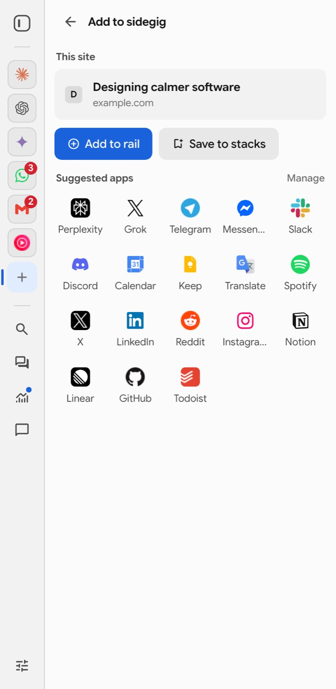
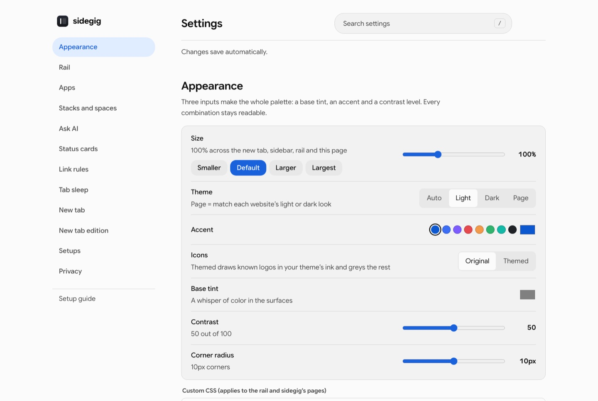
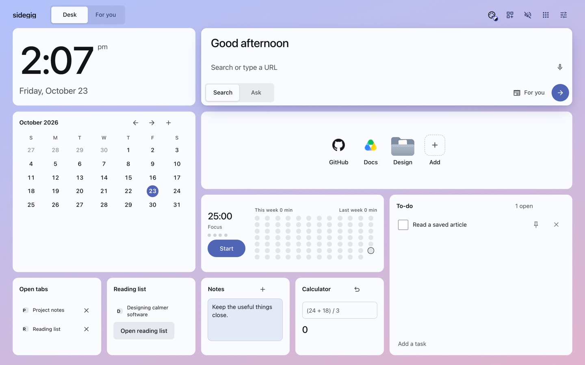

# sidegig features

The full tour of what sidegig does. The [README](../README.md) has the short version. Screenshots come from the fixture preview (`npm run preview`), so they show sample data.

## Why it exists

Opera's sidebar proved how good it is to keep messengers and tools one click away. Arc and Dia showed how calm a browser can feel. Most sidebar extensions today either open a second browser pane on the right or put features behind a subscription. sidegig is built to be:

- **Quick.** The rail is drawn on the page itself, appears after a 120 ms touch of the edge (a setting), and the drawer is preloaded.
- **Always there, like Opera's sidebar.** Docked by default: the rail sits flush on the side you choose and every page makes room for it, so nothing is ever covered. Prefer more space? Switch to hover.
- **Customizable.** Any site as an app, any bookmark folder as a space, theme from three inputs, custom CSS, per-site hiding, link rules.
- **Adaptive.** By default it matches each website's light or dark look. Text contrast is checked by tests at every setting.
- **Minimal and good looking.** A design language after Arc's: your space colour as the frame, content on calm cards, the system font, Material Symbols, nothing loud until it has something to say.
- **Free for everyone.** GPL-3.0. No paid tier, ever.

## Features

| | |
|---|---|
| **Docked rail** | Always visible on the left or right, and the page makes room for it like Opera's sidebar: fixed headers, side navs and overlays are moved clear of it automatically. Opening the drawer makes room too. Or switch to hover, where it slides over the page from the edge. |
| **Opera-style panel** | Apps open in the browser's sidebar laid out like Opera: buttons list on the outer edge, the app right beside it. When the panel opens on the rail's side, the page rail steps aside so it reads as one sidebar. If the browser puts its sidebar on the other side, sidegig offers a one-click fix. |
| **Apps** | Claude, ChatGPT, Gemini, Perplexity, Grok, WhatsApp, Telegram, Slack, Discord, Gmail, Calendar, YouTube Music, Spotify, Notion, Linear, GitHub and more, or any site. Opens in the browser's own sidebar (where your sign-ins work), a slim mini window, a tab, or an in-page drawer. Unread badges from page titles. Messengers keep running while hidden (a switch per app), any app can be muted, and each app remembers the width you give it. |
| **Add this site** | The **+** on the rail turns the page you're on into a rail app or a bookmark in one tap, with suggested apps below. |
| **One-tap AI** | The Ask button sends the page, or your selection, to your default AI. Hover it to pick Claude, ChatGPT, Gemini, Perplexity or Grok instead. Uses the account you're already signed in to: no API keys, no extra cost. sidegig types the prompt; you press send (or turn on auto-send). Also in the right-click menu. |
| **Sidebar assistant** | Built-in chat with the browser’s model, a local model, your own API provider, or your ChatGPT plan through the official Codex CLI. Open it from either rail, or right-click selected text and choose Ask the sidegig Assistant. Attach tabs, use browser tools and connect MCP tool servers. Provider keys and tool tokens stay on the device. |
| **Mail** | With the Gmail card on, sign-in codes in new mail show as a ticket you copy in one click, on the new tab and the sidebar home. Each unread email can be summarized or answered with a draft reply by the model you picked; the draft opens in Gmail for you to send. Uses the Gmail account signed in to your browser, with no extra sign-in. |
| **Agents** | Claude Code, Codex, Cursor and other MCP agents can use this browser through the local sidegig bridge, only as far as you allow: off (default), read only, or full. Every tab an agent uses shows a banner with Stop. The bridge listens on your computer only and pairs with a code. |
| **Bookmark stacks** | Your real browser bookmarks: folders become Dia/Arc-style stacks with overlapping site icons, loose bookmarks become an Opera-style icon grid. Pick folders as spaces. Syncs through the browser; stays yours if you uninstall. |
| **Tabs, Dia style** | This window's tabs with Chrome tab groups shown as colored sections. Close, switch, put background tabs to sleep, save the window as a workspace and restore it later. |
| **Search everything** | Open tabs, apps, bookmarks (with folder paths), history and commands in one fuzzy-matched list, plus web search. |
| **Status cards** | GitHub reviews and notifications, Vercel deployments, unread Gmail. Faded until something changes, then marked new; the rail glows. |
| **Link rules** | Send links for chosen sites to the sidebar (that site's app, while the sidebar is open), a mini window, or a tab that's already open. |
| **New tab page** | A desk of widgets on one grid: clock (with an optional second time zone), weather, calendar, a focus timer with twelve weeks of focus history, to-dos, notes, bookmarks with folders, reading list, open tabs and a calculator. Search and Ask share one box; an optional day summary joins the greeting. |
| **Your edition** | Every new tab carries a short, finite issue of articles, videos, podcasts, books, music and discussions picked from your interests, not from what keeps people scrolling. Your AI fills in your interests: one click types a prompt into Claude, ChatGPT or Gemini in the sidebar, and sidegig reads back only that JSON reply. Save what you like, wave off what you don't, and the next edition learns from both (interests from your AI or your saves fade over 60 days unless renewed; yours never do). A Saved shelf keeps your own curation, and right-click → “Save to your reading list” works on any page. Sources are free and keyless: Hacker News, Substack, Google News, YouTube, Apple Podcasts, Apple Music (opens in YouTube Music), Open Library, arXiv and Reddit. Where Chrome's built-in model is available, it reviews each edition on your computer and writes a one-line “why this is here” for every pick. |
| **Theme engine** | A space colour of one to three hues, with intensity and grain, frames the sidebar, the rail and the Space new tab, as in Arc. The accent follows it unless you pick one. The palette is built in OKLCH and text is checked against every stop. Auto, light, dark, or Page (match each site). Size, corner radius and custom CSS too. |

## Shortcuts

| | Windows / Linux | Mac |
|---|---|---|
| Show or hide the rail | `Alt+Shift+S` | `⌥⇧S` |
| Search everything | `Alt+Shift+K` | `⌥⇧K` |
| Ask AI about the page or selection | `Alt+Shift+A` | `⌥⇧A` |

Inside the drawer, `⌘K` / `Ctrl+K` jumps to search and `Esc` closes. Change shortcuts on your browser's extension shortcuts page.

## The edition

`src/shared/edition/` holds the logic, all pure and unit-tested against saved real responses (`test/fixtures/edition`):

- `profile.ts`: your interests, the AI import prompt and parser, and learning (save +0.5, open +0.15, not for me −0.3, 60-day fade for anything you didn't type yourself).
- `sources.ts`: one search URL and one parser per source.
- `rank.ts`: scoring (interest weight × how well it matches × how much people valued it × freshness by kind), duplicate removal, and composition: every format you turned on gets a say, stronger interests earn more slots, nothing far weaker than the best pick gets in, and the issue ends.

`src/background/edition.ts` builds a new edition on a timer (every 12 hours by default), signed out, four requests at a time. To see what a profile would produce without the extension, put an AI reply in a file and run `node scripts/edition-dry-run.ts reply.txt`.

## Design system

- **Type:** the system font (SF Pro on a Mac, Segoe UI on Windows); Barlow Condensed and IBM Plex Mono (SIL OFL) for the studio looks.
- **Icons:** Material Symbols Rounded (Apache-2.0), fetched by `scripts/fetch-assets.mjs`.
- **Color:** a space colour of one to three hues frames navigation; content sits on white or near-black cards; the accent follows the space colour unless you pick one; contrast tested (body text ≥ 7:1, secondary ≥ 4.5:1).
- **Shape and motion:** corners from 3 to 14 px; a soft lift only on floating layers and the selected item; spring motion that settles without overshoot, 120 to 480 ms; respects reduced motion.
